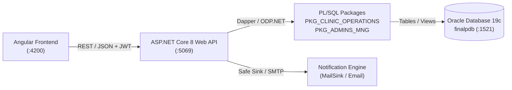

# Clinic Appointment Management System
## Master Unified Final Submission

A comprehensive, enterprise-grade Clinic Appointment Management System featuring an **Angular 21** single-page frontend, an **ASP.NET Core 8 Web API** 3-tier backend, and **Oracle Database 19c** with native PL/SQL stored procedure packages.

---

## 1. Project Overview

The Clinic Appointment Management System provides an end-to-end healthcare workflow connecting patients, clinical staff, and administrators:
- **Patient Portal**: Search and filter doctors by medical specialty, view doctor qualifications, working hours, and book available appointment slots in real-time. Immediate reference number generation, appointment confirmation lookup, and appointment self-cancellation.
- **Admin Management Portal**: Role-based access control (RBAC), JWT authentication with NIST PBKDF2 password hashing, real-time KPI statistics dashboard, dynamic specialty appointment breakdown charts, and full CRUD management for doctors, specialties, appointment schedules, patients, and administrators.
- **Email Notification System**: Automated appointment confirmations, cancellation notices, and administrator alerts with safe local sink file logging by default (and optional SMTP relay).
- **Enterprise Database Layer**: 8 relational tables, performance indexes, analytical views, and 8 Oracle PL/SQL packages encapsulating business operations and concurrency control.

---

## 2. Technology Stack

| Layer | Technology | Version |
| :--- | :--- | :--- |
| **Frontend** | Angular Single Page Application (SPA), TypeScript, LESS, RxJS | Angular 21, TypeScript 5.9 |
| **Backend API** | ASP.NET Core Web API, C#, .NET 8, Swagger/OpenAPI | .NET 8.0 (SDK 10.0+ compatible) |
| **Data Access** | Dapper Micro-ORM, Dapper.Oracle, Oracle.ManagedDataAccess.Core | Dapper 2.1+, ODP.NET Core 23c |
| **Database** | Oracle Database Enterprise / Standard Edition / XE | Oracle Database 19c (19.3+) |
| **Authentication** | JWT Bearer Tokens, NIST PBKDF2 Hashing (100k iter, 128-bit salt) | HMAC-SHA256, BCrypt/Legacy SHA-256 fallback |

---

## 3. Required IDEs & Development Tools

- **Visual Studio 2022** (v17.8+ with *.NET desktop development* and *ASP.NET and web development* workloads)
- **Visual Studio Code** (with Angular Language Service and C# Dev Kit extensions)
- **Oracle SQL Developer** (v21+ or v23+) or **SQL*Plus** command-line utility
- **Node.js** (v20.x, v22.x, or v24.x LTS) & **npm** (v10+ or v11+)
- **.NET 8 SDK** (v8.0.x or higher)

---

## 4. Repository Structure

```text
Final-Submission/
├── Database/
│   ├── 00_RUN_ALL.sql       # Master deployment script (executes all scripts in order)
│   ├── 01_SCHEMA.sql        # Tables, sequences, indexes, and relational constraints
│   ├── 02_VIEWS.sql         # Real-time dashboard and analytical views
│   ├── 03_PACKAGES.sql      # PL/SQL package specifications and package bodies
│   └── 04_SEED_DATA.sql     # Dependency-ordered seed data (Roles, Admins, Doctors, etc.)
├── Backend/
│   ├── Clinic Management System.sln
│   ├── Clinic Management System.API/
│   │   ├── Controllers/     # Admin, Auth, Doctors, Appointments, Patients, Specialties, Dashboard
│   │   ├── Program.cs       # Service configuration, Swagger, JWT Bearer, CORS
│   │   ├── appsettings.json # Oracle connection string, JWT, Email settings
│   │   └── MailSink/        # Local sink storage for outbound notification emails
│   ├── Clininc Management System.Core/
│   │   ├── Models/          # Admin, Doctor, Patient, Appointment, Specialty, Role
│   │   ├── DTOs/            # Request/Response Data Transfer Objects
│   │   ├── Repository/      # Repository interfaces (IRepositories.cs)
│   │   └── Service/         # Service interfaces (IServices.cs, IEmailService.cs)
│   └── Clininc Management System.infra/
│       ├── Common/          # DbContext (ODP.NET), PasswordSecurity (PBKDF2)
│       ├── Repository/      # Dapper & Stored Procedure implementations (Repositories.cs)
│       └── Service/         # Business logic & EmailService implementation
└── Frontend/
    ├── src/
    │   ├── app/
    │   │   ├── components/  # Navbar, Footer
    │   │   ├── guards/      # AuthGuard (JWT client-side route guard)
    │   │   ├── models/      # TypeScript interfaces and models
    │   │   ├── pages/       # Home, Doctors, Details, Book, My Appointments, Admin Portal
    │   │   └── services/    # ApiService, AuthService, NotificationService
    │   ├── index.html
    │   └── styles.less
    ├── angular.json
    ├── package.json
    └── tsconfig.json
```

---

## 5. Database Installation & Setup

### Step 1: Verify Oracle Service and Listener
Ensure your Oracle Database 19c service and listener are running:
```powershell
Get-Service OracleService* | Select-Object Name, Status
lsnrctl status
```

### Step 2: Create Application User / Schema (as SYSDBA)
Connect to your Pluggable Database (e.g. `finalpdb` or `orclpdb`):
```sql
ALTER SESSION SET CONTAINER = finalpdb;

CREATE USER my_user IDENTIFIED BY "<YOUR_STRONG_PASSWORD>"
    DEFAULT TABLESPACE USERS
    QUOTA UNLIMITED ON USERS;

GRANT CONNECT, RESOURCE, CREATE VIEW, CREATE PROCEDURE, CREATE SEQUENCE, CREATE TABLE TO my_user;
```

### Step 3: Execute Master Deployment Script
Navigate to the `Database` directory and run:
```powershell
cd Database
sqlplus my_user/<YOUR_STRONG_PASSWORD>@localhost:1521/finalpdb @00_RUN_ALL.sql
```
This script automatically executes in strict dependency order:
1. `01_SCHEMA.sql` — Drops existing objects safely, creates tables, sequences, and indexes.
2. `02_VIEWS.sql` — Creates `Vw_AdminDashboardStats` and `Vw_AppointmentsBySpecialty`.
3. `03_PACKAGES.sql` — Compiles all 8 PL/SQL packages and bodies without errors.
4. `04_SEED_DATA.sql` — Seeds realistic clinic records and synchronizes identity sequences with `START WITH LIMIT VALUE`.

---

## 6. Backend Configuration & Execution

### Step 1: Configure Connection String & Settings
Review `Backend/Clinic Management System.API/appsettings.json`:
```json
{
  "ConnectionStrings": {
    "DBConnectionString": "Data Source=(DESCRIPTION=(ADDRESS=(PROTOCOL=TCP)(HOST=localhost)(PORT=1521))(CONNECT_DATA=(SERVER=DEDICATED)(SERVICE_NAME=YOUR_PDB_NAME)));User Id=YOUR_DB_USERNAME;Password=YOUR_DB_PASSWORD;"
  },
  "JwtSettings": {
    "Secret": "YOUR_SECURE_JWT_SECRET_KEY_MINIMUM_32_CHARACTERS_LONG!",
    "Issuer": "ClinicAPI",
    "Audience": "ClinicClient",
    "DurationInDays": 7
  },
  "EmailSettings": {
    "SafeDeliveryMode": "LocalSink",
    "LocalSinkPath": "MailSink",
    "SenderEmail": "no-reply@clinic.com",
    "SenderName": "Clinic Appointment Management System"
  }
}
```

### Step 2: Restore & Build Solution
Open a terminal in `Final-Submission/Backend`:
```powershell
dotnet restore "Clinic Management System.sln"
dotnet build "Clinic Management System.sln"
```

### Step 3: Run the API Server
```powershell
dotnet run --project "Clinic Management System.API\Clinic Management System.API.csproj" --launch-profile "http"
```
The API server will launch and listen on:
- **Base URL**: `http://localhost:5069`
- **Swagger Documentation**: `http://localhost:5069/swagger`

---

## 7. Frontend Installation & Execution

### Step 1: Install Node Dependencies
Open a terminal in `Final-Submission/Frontend`:
```powershell
cd A:\Rama-Project\Final-Submission\Frontend
npm install
```
*(Or use `npm ci` if reproducible lockfile installation is preferred).*

### Step 2: Build the Application
```powershell
npm run build
```

### Step 3: Start the Angular Development Server
```powershell
npm start
```
The Angular Single Page Application will be served at:
- **Local Application URL**: `http://localhost:4200`

---

## 8. Initial Administrator Provisioning

The database is pre-seeded with a default administrator account:
- **Username**: `admin`
- **Password**: `admin123`
- **Role**: `Admin`
- **Email**: `admin@clinic.com`

*Security Note: The password is encrypted using NIST PBKDF2 (HMAC-SHA256, 100,000 iterations, 128-bit random salt). A transparent migration path is included that seamlessly verifies and upgrades any legacy plain or SHA-256 passwords upon first login.*

To log in:
1. Open `http://localhost:4200/admin/login` in your web browser.
2. Enter the credentials above.
3. Upon authentication, you will be redirected to the **Admin Dashboard** (`http://localhost:4200/admin/dashboard`).

---

## 9. System Integration & Verified Workflows

The three layers operate as one integrated system:



### Tested & Verified Workflows:
1. **Browse Doctors & Filter**: Patients can filter doctors by specialty, search by keyword, and inspect consultation fees and ratings.
2. **Book Appointment**: Select an active doctor, choose a date, pick from live available slots, enter patient information, and receive a permanent booking reference (`REF-YYYYMMDD-XXXX`).
3. **Double Booking Prevention**: The Oracle package acquires row-level locks (`FOR UPDATE`) on the target slot, preventing race conditions and double bookings.
4. **Appointment Management & Cancellation**: Patients or admins can look up an appointment by reference number and cancel it. The slot availability is immediately restored to available status (`IsAvailable = 1`).
5. **Admin Operations**: Administrators can view real-time KPI metrics, visualize specialty appointment distribution, manage clinic staff, and create new administrators.
6. **Automated Email Notifications**: Booking confirmation and cancellation notifications are dispatched and safely archived in `Backend/Clinic Management System.API/MailSink/`.

---

## 10. Troubleshooting Guide

| Issue | Root Cause | Solution |
| :--- | :--- | :--- |
| **ORA-12541 / ORA-12514: TNS no listener** | Oracle Listener is not running or PDB is not mounted | Run `lsnrctl start` in cmd. In `sqlplus / as sysdba`, execute `ALTER PLUGGABLE DATABASE finalpdb OPEN;`. |
| **ORA-20008 / DUP_VAL_ON_INDEX on ID** | Identity column sequence out of sync after manual ID inserts | In SQL*Plus, run: `ALTER TABLE <TABLE_NAME> MODIFY (<ID_COL> GENERATED BY DEFAULT AS IDENTITY (START WITH LIMIT VALUE));` |
| **CORS Error in Browser Console** | API CORS policy missing or API not running | Verify backend is running on `http://localhost:5069`. `Program.cs` includes `UseCors("AllowAll")`. |
| **Port 5069 or 4200 already in use** | A previous instance is still running in background | Check active ports with `Get-NetTCPConnection -LocalPort 5069, 4200` and stop the conflicting process. |
| **Angular LESS compilation error** | Missing devDependency `less` | Run `npm install less --save-dev` in `Final-Submission/Frontend`. |
