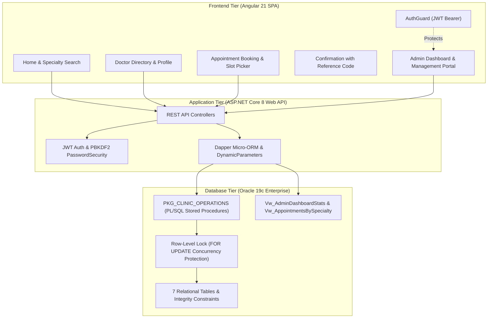

# Clinic Appointment Management System ("Al-Amal Clinic")
## University Final Project #9 – Full-Stack Enterprise Healthcare Platform

[](https://dotnet.microsoft.com/)
[](https://angular.dev/)
[](https://www.oracle.com/database/)
[](https://github.com/DapperLib/Dapper)
[](https://jwt.io/)
[](https://playwright.dev/)

An enterprise-grade clinic management and appointment booking platform developed for **University Final Project #9**. The system integrates an **Oracle Database 19c Enterprise Edition** backend, a **3-tier ASP.NET Core 8.0 Web API** using Dapper, and a modern **Angular 21 Single Page Application (SPA)** with responsive styling and reactive form validation.

---

## 🏛️ System Architecture



---

## 🚀 Key Functional Capabilities

### Public Patient Portal
- **Home Page**: Interactive medical specialties, featured doctor profiles, working hours, and search.
- **Doctor Directory**: Search by doctor name, instant specialty filter pills, and sorting by fee/name.
- **Doctor Details & Schedules**: Qualifications, consultation fees, weekly working hours, and real-time available time slots.
- **Patient Registration**: Client and server-side validation; automatic duplicate phone verification.
- **Appointment Booking**: Select doctor, appointment date, and available slot; atomic persistence in Oracle.
- **Double-Booking Concurrency Protection**: Pessimistic `SELECT ... FOR UPDATE` row locks in Oracle PL/SQL serialize simultaneous requests, returning `HTTP 409 Conflict` to subsequent attempts.
- **Instant Booking Confirmation**: Generates a unique reference code (`APT-...`) and displays full booking details.
- **Appointments Directory**: View scheduled appointments, filter by date and status, and cancel eligible bookings (automatically reopening the slot in Oracle).

### Administrative Management Portal
- **Secure Admin Authentication**: Protected with **NIST-compliant PBKDF2** password hashing (100,000 iterations of HMAC-SHA256, random 128-bit salt), transparent auto-migration of legacy hashes, and JWT Bearer token generation.
- **Live KPI Dashboard**: Real-time counters for Total Doctors, Total Patients, Total Appointments, Scheduled, Completed, and Cancelled appointments querying `Vw_AdminDashboardStats`.
- **Specialty Distribution Analytics**: Visual distribution chart of appointments by medical specialty querying `Vw_AppointmentsBySpecialty`.
- **Doctor Management**: Full CRUD operations for doctor profiles, consultation fees, weekly working hour editing, and appointment slot generation.
- **Specialty Catalog Management**: Create, edit, and delete medical departments.
- **Patient Registry**: Query, search, view detailed profiles, edit patient contact info, and manage patient records.
- **Appointment Lifecycle**: Manage and update appointment statuses (`Scheduled` ➔ `Completed` / `Cancelled`) with automatic slot status synchronization.

---

## 📦 University Deliverables Directory

| # | University Deliverable | Repository Path | Description |
| :- | :--- | :--- | :--- |
| **1** | **Oracle Database Scripts** | [`database_project/ClinicAppointmentManagementSystem.sql`](database_project/ClinicAppointmentManagementSystem.sql) | DDL schema, foreign key cascades, constraints, views, `PKG_CLINIC_OPERATIONS` package, and rich seed data. |
| **2** | **Entity-Relationship Diagram** | [`database_project/erdplus.png`](database_project/erdplus.png) | Complete ERD showing all 7 tables, attributes, primary keys, and cardinalities. |
| **3** | **ASP.NET Core Web API** | [`Clinic Management System/`](Clinic%20Management%20System/) | Clean 3-tier architecture (`API`, `Core`, `infra`) with Dapper, JWT, and Swagger. |
| **4** | **Angular Frontend App** | [`Frontend_Clinic/`](Frontend_Clinic/) | Angular 21 Single Page Application with all 14 clinical and administrative views. |
| **5** | **Screenshots Suite** | [`screenshots/`](screenshots/) | 17 verified high-resolution PNG captures covering desktop workflows, admin portal, and mobile layout. |
| **6** | **PowerPoint Presentation** | [`presentation/Clinic_Appointment_Management_System_Presentation.pptx`](presentation/Clinic_Appointment_Management_System_Presentation.pptx) | 11-slide widescreen presentation deck covering architecture, schema, concurrency, and QA. |

---

## 🛠️ Quick Start & Setup Guide

### Prerequisites
1. **.NET 8.0 SDK** ([Download](https://dotnet.microsoft.com/download/dotnet/8.0))
2. **Node.js (v18+ or v20+) & npm** ([Download](https://nodejs.org/))
3. **Oracle Database 19c Enterprise Edition / 21c / Express (XE)** running locally on port `1521` with service `ORCLPDB` (or custom SID).

---

### Step 1: Database Setup (Oracle 19c)
Open SQL*Plus as `SYSDBA`:
```sql
sqlplus sys/your_sys_password@localhost:1521/ORCLPDB as sysdba
```
Execute the following to create the dedicated schema:
```sql
CREATE USER CLINIC_USER IDENTIFIED BY clinic123 DEFAULT TABLESPACE USERS QUOTA UNLIMITED ON USERS;
GRANT CONNECT, RESOURCE, CREATE VIEW, CREATE PROCEDURE, CREATE SEQUENCE TO CLINIC_USER;
EXIT;
```
Run the automated schema and seed data script:
```bash
sqlplus CLINIC_USER/clinic123@localhost:1521/ORCLPDB @database_project/ClinicAppointmentManagementSystem.sql
```

---

### Step 2: Backend Setup (ASP.NET Core Web API)
Navigate to the API directory:
```bash
cd "Clinic Management System/Clinic Management System.API"
dotnet restore
dotnet run --urls "http://localhost:5069"
```
- API Base URL: `http://localhost:5069/api`
- Interactive Swagger / OpenAPI: `http://localhost:5069/swagger`

*Configuration note: Database connection and JWT settings are externalized in `appsettings.json` and `appsettings.Development.json`. For production, override via environment variables `ConnectionStrings__DBConnectionString` and `JwtSettings__Secret`.*

---

### Step 3: Frontend Setup (Angular 21)
Open a new terminal and navigate to the frontend directory:
```bash
cd "Frontend_Clinic"
npm install
npm start -- --port 4200
```
- Web Application URL: `http://localhost:4200`
- Default Administrator Credentials:
  - **Username**: `admin`
  - **Password**: `admin123`

---

## 🔒 Security & Data Integrity

1. **NIST PBKDF2 Password Hashing**:
   - `PasswordSecurity.cs` uses `Rfc2898DeriveBytes.Pbkdf2` with HMAC-SHA256, 100,000 iterations, and a 128-bit cryptographically secure random salt.
   - Includes transparent auto-migration: existing legacy admin accounts are automatically upgraded upon successful authentication.
2. **JWT Authorization**:
   - Claims-based JWT Bearer tokens issued upon login with strict expiration and signature validation.
   - Protected routes guarded on the frontend via `AuthGuard` and enforced on the backend via `[Authorize]`.
3. **Double-Booking Prevention**:
   - In `PKG_CLINIC_OPERATIONS.BOOK_APPOINTMENT`:
     ```sql
     SELECT IsAvailable INTO v_IsAvailable FROM AppointmentSlots WHERE SlotId = p_SlotId FOR UPDATE;
     IF v_IsAvailable = 0 THEN
         RAISE_APPLICATION_ERROR(-20002, 'Selected appointment slot is no longer available.');
     END IF;
     ```
   - Race conditions are eliminated at the database engine level; competing parallel requests receive `HTTP 409 Conflict`.

---

## 🧪 Quality Assurance & Verification

- **ASP.NET Core Build**: Clean compilation in Release mode (`0 Error(s), 0 Warning(s)`).
- **Angular Production Build**: Production bundle optimized (`0 Error(s), 0 Warning(s)`).
- **Automated Security & Admin QA** (`verify_security_and_management.py`):
  - 100% pass on authentication, PBKDF2 verification, token issuance, 401 unauthorized rejection on protected routes, and patient/schedule management.
- **Playwright Browser E2E Suite** (`run_qa_and_screenshots.py`):
  - 14 automated visual and functional scenarios executed in headless Chrome with zero console errors.
